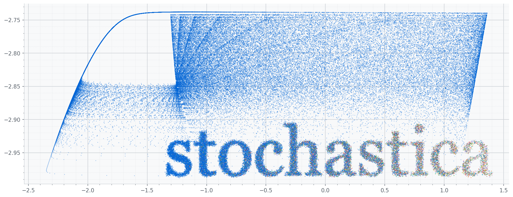

# Stochastica

Stochastica provides mathematical SuperCollider UGens for generative music: nonlinear maps and flows, shaped probability distributions, stochastic trajectories, event timing, discrete state and interacting populations. Raw state is separate from sonic mapping, so a patch can expose what a model remembers and how it organizes change.

Deterministic maps and flows can be periodic, excitable or chaotic depending on parameters. Stochastic models consume random innovations. Independent triggered distributions, mean-reverting motion, event feedback and accumulated preference introduce different kinds of structure; the installed Stochastica guide explains these relationships across all 61 UGens and the language-side `SDPhaseView` utility.

This remains in BiroSCa as an experimental SuperCollider-native collection independently implementing mathematical techniques, rather than wrapping an upstream plugin. Equations, adaptations and citations are documented in each help page and the [source notes](docs/sources.md).

## GENDY waveform synthesis

Eight additions bring stochastic processes directly into evolving waveform geometry. The dedicated **Stochastica Gendy (Xtochastica)** help guide explains their historical sources, mathematical differences and practical use alongside the existing Gendy1–5 family.

- `Gendy77` evolves remembered amplitudes and segment durations with first-order reflected walks. It reconstructs the method associated with Xenakis's 1977 DSS, using explicit modern seeding and duration scaling.
- `Gendy91` gives each breakpoint two levels of stochastic memory. Primary reflected walks drive secondary amplitude/duration walks, following the method associated with GENDY3 and crediting Xenakis and Marie-Hélène Serra.
- `GendyS709` periodically changes the rules of first-order waveform motion. Sine/saw modulation is historically informed; its exponential control routes are explicit Stochastica choices.
- `GendyField` supplies independently timed sound/silence gates. Exponential durations and Bernoulli activity implement the PARAG timing subset, without recreating its complete sections.
- `GendyPerc` contracts stochastic mobility after each trigger. Brown and Jenkins's IDSS work informs its two-level walk and transition from rough motion to a stable polygon, independently of volume envelopes.
- `GendyInterp` renders identical breakpoint histories with hold, linear, cosine or zero-tangent cubic Hermite interpolation. This extends the rendering vocabulary without claiming exact equivalence to sc3-plugins Gendy4/5.
- `GendyDiffusion` maps radial diffusion into waveform amplitudes at fixed pitch. It implements Rojas and Cádiz’s published Bessel-process DDSS concept with explicit timestep, origin regularization and angular-mapping choices.
- `GendyCoupled` makes neighboring breakpoint proposals interact around a ring. Its synchronous discrete Laplacian is a new Stochastica design, with exact uncoupled-baseline behavior at zero coupling.

Waveform classes are audio-only with 2–64 points; GendyField is control-only with 1–32 gates. These oscillators are not bandlimited and can contain DC. Bounds, initialization, scheduling and interpolation differ intentionally from the original programs. GendyDiffusion uses the full-paper equations with documented numerical choices; it is not a bit-exact recreation of the authors’ Max instrument.

See the [implementation decisions](docs/gendy-implementation.md), [research audit](docs/research/GENDY_HISTORICAL_SOURCES.md), and [verification record](docs/gendy-verification.md).

## Round 3 expansion

Eight additions develop memory, hidden organization, constrained geometry, transport and collective dynamics. They continue the existing Stochastica project; existing DSP and seeded behavior are preserved.

- `MaternNoise` generates Gaussian trajectories with separate variance, correlation-time and smoothness controls. Exact finite-step linear-SDE transitions implement the half-integer Matérn family through derivative-state memory.
- `TDirichletRand` distributes a unit budget among nonnegative shares on each trigger. Bounded Gamma sampling in log space preserves sparse allocations at small concentrations.
- `PolyaUrn` reinforces the probability of previously selected states. Private accumulated weights expose path dependence, pre-selection probability and post-selection entropy.
- `MarkovModulatedTrig` gives one event stream persistent quiet or dense regimes. A latent Markov state controls bounded discrete-hazard event timing independently of observed events.
- `LevyFlight` accumulates symmetric stable increments into unbounded transport. Exact elapsed-time scaling distinguishes heavy-tailed relocations from correlated fractional motion.
- `JumpDiffusion` combines Brownian wandering with finite-rate Gaussian-marked Poisson shocks. An aggregate jump draw exposes state, jump flag, displacement and count without a per-shock loop.
- `WilsonCowan` models feedback between excitatory and inhibitory population activities. Fixed-substep RK4 integrates a normalized logistic variant of the population equations with optional external stochastic drive.
- `Lorenz96` evolves locally coupled continuous states around a ring. Linear-cost cyclic RK4 stages expose spatially extended deterministic dynamics, distinct from trigger-driven coupled maps.

Each addition has audio/control rates, a sourced help page, small runnable examples and a reproducible figure. The guide audits the original collection and both expansions, with comparisons of memory, regimes, movement and interaction. See the [Round 3 implementation](docs/round3-implementation.md) and [verification record](docs/round3-verification.md).

Dirichlet dimension is at most 32; urn states, latent states and Lorenz cells at most 64. Event/state rates in MarkovModulatedTrig should stay well below the calculation rate. Matérn coefficient parameters are sampled at block entry. JumpDiffusion rejects Poisson means above 1e8 per calculation. Flow substeps are limited to 16; 64-cell Lorenz96 at 16 audio-rate substeps can exceed a core's real-time budget. Heavy-tailed/raw outputs require explicit sonic mapping, and the flows do not provide antialiasing.

## Round 2 expansion

Eight new models extend Stochastica's stochastic organization. This work continues Stochastica's experimental, SuperCollider-native generative systems; existing UGen behavior is preserved.

- `MultiHawkesTrig` spreads activity between event streams through directional cross-excitation. A bounded exponential-kernel Hawkes network draws simultaneous events before updating its interaction matrix.
- `SelfCorrectingTrig` produces random events that resist clustering. Its log-intensity builds during silence and falls after an event, providing inhibitory feedback beside `HawkesTrig`.
- `RandomTelegraph` switches between two persistent regimes with asymmetric random dwell times. Integrated exponential hazards preserve timing under ordinary rate modulation.
- `ShotNoise` accumulates Gaussian-marked Poisson impacts into a decaying signal. Analytical inter-event decay connects isolated particles to dense continuous textures.
- `MultiOUProcess` generates correlated trajectories with temporal memory. Exact finite-step OU covariance combines the scalar process's mean reversion with `MultiGaussNoise`-style matrix handling.
- `DoubleWellProcess` produces continuous metastable motion and noise-driven barrier crossings. Fixed Euler–Maruyama substeps expose the raw quartic-potential dynamics without audio-range clipping.
- `TVonMisesRand` samples angles around a preferred direction. Bounded Best–Fisher rejection treats the wrap boundary as part of a circle.
- `KuramotoNetwork` models an oscillator population that can synchronize through mutual coupling. A linear-cost mean-field update exposes every phase, coherence, and mean phase.

Telegraph and shot scheduling process at most eight internal events per calculation; overload carries time forward and can delay the model. Hawkes/self-correcting events use a discrete hazard approximation, so individual rates should remain well below the calculation rate. Vector reloads are explicit snapshots; OU factorization costs more than an ordinary update. Kuramoto and double-well integration need suitable time steps, and raw outputs are not normalized or antialiased.

See the installed Stochastica guide, [implementation record](docs/round2-implementation.md), and [verification record](docs/round2-verification.md). This expansion stays in BiroSCa because it develops experimental SuperCollider-native generative systems from mathematical techniques rather than wrapping an upstream plugin.

## Design

- A raw map updates recurrence state only on a rising trigger.
- A flow integrates differential equations at the UGen calculation rate.
- A distribution sampler produces an independent value on a rising trigger.
- A stochastic process carries random state through time.
- An event process emits one-sample or one-control-block events.
- A sonifier explicitly folds and maps raw-map state into audio.

Seeded classes use a local PCG32 generator. An explicit nonzero seed repeats the local algorithmic sequence for the same inputs and calculation rate; zero derives a seed from the parent Synth generator at construction. Reset restores the original local seed. Floating-point library differences may affect last-bit values across platforms.

## Classes

### Raw maps

- `HenonMap` outputs both coordinates of the Hénon recurrence. It samples parameters on trigger edges, holds between events, and resets rather than conditioning divergent state.
- `GbmanMap` outputs the Gingerbreadman map's two raw coordinates. Its recurrence is shared with the explicit `GbmanSonify` wrapper.
- `LatoocarfianMap` exposes one documented two-sine Latoocarfian recurrence. No interpolation, normalization, or frequency mapping occurs inside the raw map.
- `IkedaMap` implements the two-dimensional Ikeda map. Parameters remain unclipped and non-finite results restore the requested initial state.
- `LoziMap` implements the piecewise-linear Lozi recurrence. It holds raw state between rising trigger edges.
- `TinkerbellMap` emits both coordinates of the Tinkerbell polynomial map. Old-state values are used consistently for both next coordinates.
- `CliffordMap` implements Clifford's trigonometric attractor equations. Output is mathematical state rather than normalized audio.
- `DeJongMap` implements Peter de Jong's two-dimensional trigonometric recurrence. It is trigger driven and exposes both coordinates.
- `CircleMap` implements the normalized standard circle map. Wrapping to `[0, 1)` is part of the map definition.
- `CoupledLogisticMap` implements two symmetrically coupled logistic maps. It deliberately leaves states outside `[0, 1]` visible.
- `CoupledMapLattice` runs 2–64 periodically coupled logistic cells. Two RT-allocated arrays are swapped after each trigger-driven update.
- `RulkovMap` implements the two-state discrete Rulkov neuron model. It can expose quiescent, spiking, or bursting trajectories.

### Continuous systems

- `MackeyGlass` integrates the Mackey–Glass delay equation. It uses an RT-allocated circular history, cubic delay reads, and a fixed Heun step.
- `Chua` outputs all three states of Chua's circuit equations. It uses fixed-substep RK4 integration without output normalization.
- `Izhikevich` outputs membrane potential, recovery state, and a one-calculation spike trigger. It uses the canonical two-half-step voltage update.
- `KuramotoNetwork` models an oscillator population that can synchronize through mutual coupling. A linear-cost mean-field update exposes every phase, coherence, and mean phase.
- `WilsonCowan` models feedback between excitatory and inhibitory population activities. Fixed-substep RK4 integrates a normalized logistic variant of the population equations with optional external stochastic drive.
- `Lorenz96` evolves locally coupled continuous states around a ring. Linear-cost cyclic RK4 stages expose spatially extended deterministic dynamics, distinct from trigger-driven coupled maps.

### Stochastic and event processes

- `OUProcess` implements the exact finite-step Ornstein–Uhlenbeck transition and its Brownian limit. Control rate uses the full control duration.
- `RenewalTrig` schedules exponential, gamma, Weibull, lognormal, or Erlang intervals. It emits at most one event per calculation and carries timing remainder.
- `HawkesTrig` implements a bounded self-exciting point process. Its second output is the pre-event intensity used for the probability.
- `MultiHawkesTrig` spreads activity between event streams through directional cross-excitation. A bounded exponential-kernel Hawkes network draws simultaneous events before updating its interaction matrix.
- `SelfCorrectingTrig` produces random events that resist clustering. Its log-intensity builds during silence and falls after an event, providing inhibitory feedback beside `HawkesTrig`.
- `RandomTelegraph` switches between two persistent regimes with asymmetric random dwell times. Integrated exponential hazards preserve timing under ordinary rate modulation.
- `ShotNoise` accumulates Gaussian-marked Poisson impacts into a decaying signal. Analytical inter-event decay connects isolated particles to dense continuous textures.
- `DoubleWellProcess` produces continuous metastable motion and noise-driven barrier crossings. Fixed Euler–Maruyama substeps expose the raw quartic-potential dynamics without audio-range clipping.
- `MaternNoise` generates Gaussian trajectories with separate variance, correlation-time and smoothness controls. Exact finite-step linear-SDE transitions implement the half-integer Matérn family through derivative-state memory.
- `LevyFlight` accumulates symmetric stable increments into unbounded transport. Exact elapsed-time scaling distinguishes heavy-tailed relocations from correlated fractional motion.
- `JumpDiffusion` combines Brownian wandering with finite-rate Gaussian-marked Poisson shocks. An aggregate jump draw exposes state, jump flag, displacement and count without a per-shock loop.
- `FractionalNoise` approximates finite-band `1/f^alpha` noise with normalized logarithmically spaced OU components. Quality selects 4–32 components.
- `FBrownianMotion` is a control-rate finite-memory ARFIMA-style fractional Brownian approximation. It filters normalized Gaussian innovations.
- `BoundedWalk` provides reflect, wrap, clip, bounded-resample, and absorb rules with uniform, normal, or Cauchy increments.

### Triggered distributions

- `TGammaRand` uses bounded Marsaglia–Tsang gamma sampling. Shape below one uses the standard shape-boost transform.
- `TWeibullRand` uses an open-uniform inverse transform. Shape and scale retain their conventional meanings.
- `TLogNormalRand` exponentiates a normal draw and converts overflow to the largest finite float. Sigma is interpreted by magnitude.
- `TCauchyRand` uses the tangent inverse transform. Extreme finite values are expected because no finite mean or variance exists.
- `TPoissonRand` uses bounded Knuth sampling for small means and PTRS rejection for large means. Output is an integer represented as float.
- `TGeometricRand` returns failures before the first success. Endpoint probabilities have explicit finite fallbacks.
- `TNegBinomialRand` uses a gamma–Poisson mixture and supports positive real success counts. It returns failures before the requested successes.
- `TTruncNormalRand` uses normal-CDF and inverse-CDF sampling. It samples the conditioned distribution instead of clipping a normal draw.
- `TStableRand` uses Chambers–Mallows–Stuck sampling in Nolan's S0 parameterization. Gaussian and Cauchy special cases are documented.
- `TLevyRand` uses the inverse-square normal construction with a bounded retry loop. It has one-sided support and an expected heavy tail.
- `TVonMisesRand` samples angles around a preferred direction. Bounded Best–Fisher rejection treats the wrap boundary as part of a circle.
- `TDirichletRand` distributes a unit budget among nonnegative shares on each trigger. Bounded Gamma sampling in log space preserves sparse allocations at small concentrations.

### State and multivariate processes

- `MarkovChain` samples a live row-major transition-weight buffer and optionally maps states through a value buffer. User buffers are never rewritten.
- `SemiMarkov` combines the same matrix with per-state fixed, exponential, gamma, Weibull, or lognormal dwell times. It reports change and remaining time.
- `MultiGaussNoise` factors a covariance buffer at construction, reset, or reload. Failed Cholesky attempts use bounded diagonal jitter and a diagonal fallback.
- `MultiOUProcess` generates correlated trajectories with temporal memory. Exact finite-step OU covariance combines the scalar process's mean reversion with `MultiGaussNoise`-style matrix handling.
- `PolyaUrn` reinforces the probability of previously selected states. Private accumulated weights expose path dependence, pre-selection probability and post-selection entropy.
- `MarkovModulatedTrig` gives one event stream persistent quiet or dense regimes. A latent Markov state controls bounded discrete-hazard event timing independently of observed events.

### Dynamic stochastic synthesis (GENDY)

- `Gendy77` evolves remembered amplitudes and segment durations with first-order reflected walks. It reconstructs the method associated with Xenakis's 1977 DSS, using explicit modern seeding and duration scaling.
- `Gendy91` gives each breakpoint two levels of stochastic memory. Primary reflected walks drive secondary amplitude/duration walks, following the method associated with GENDY3 and crediting Xenakis and Marie-Hélène Serra.
- `GendyS709` periodically changes the rules of first-order waveform motion. Sine/saw modulation is historically informed; its exponential control routes are explicit Stochastica choices.
- `GendyField` supplies independently timed sound/silence gates. Exponential durations and Bernoulli activity implement the PARAG timing subset, without recreating its complete sections.
- `GendyPerc` contracts stochastic mobility after each trigger. Brown and Jenkins's IDSS work informs its two-level walk and transition from rough motion to a stable polygon, independently of volume envelopes.
- `GendyInterp` renders identical breakpoint histories with hold, linear, cosine or zero-tangent cubic Hermite interpolation. This extends the rendering vocabulary without claiming exact equivalence to sc3-plugins Gendy4/5.
- `GendyDiffusion` maps radial diffusion into waveform amplitudes at fixed pitch. It implements Rojas and Cádiz’s published Bessel-process DDSS concept with explicit timestep, origin regularization and angular-mapping choices.
- `GendyCoupled` makes neighboring breakpoint proposals interact around a ring. Its synchronous discrete Laplacian is a new Stochastica design, with exact uncoupled-baseline behavior at zero coupling.

### Explicit sonifiers

- `HenonSonify`, `GbmanSonify`, and `LatoocarfianSonify` map selected coordinates to iteration frequency and level. Folding ranges, selection, frequency bounds, and hold/linear/cubic-Hermite interpolation are explicit.

### Visualization utility

- `SDPhaseView` is a language-side bounded phase-portrait window for two-output state UGens. It visualizes and sonifies one shared server state, transports coordinates only at display rate, and performs all storage and drawing outside the audio thread.

## Building

```bash
cmake -S . -B build \
  -DSC_PATH=/path/to/supercollider-source \
  -DCMAKE_BUILD_TYPE=Release \
  -DSTRICT=ON
cmake --build build --config Release
cmake --install build --config Release
```

Install the staged `Stochastica` folder in the SuperCollider user extension directory and recompile the class library. For supernova, configure with `-DSUPERNOVA=ON`.

Configure with `-DBUILD_TESTING=ON` and run `ctest --test-dir build --output-on-failure` for the numerical, statistical and server ABI checks. Local server/doc commands and performance limits are in the [verification record](docs/round3-verification.md). Platform verification workflows stage architecture-labeled extension artifacts; this source expansion has not been published.

## Buffer formats

- `CoupledMapLattice`: at least `numCells` samples.
- `MarkovChain`: one-channel, row-major `numStates * numStates` transition weights; optional one-channel values.
- `SemiMarkov`: the same matrix plus a three-channel duration buffer containing mean seconds, shape, and distribution code.
- `MultiGaussNoise`: one-channel, row-major covariance matrix; optional one-channel mean vector.
- `TDirichletRand`: mono positive concentration vector.
- `PolyaUrn`: mono nonnegative base weights with positive total; optional finite value vector.
- `MarkovModulatedTrig`: mono row-major transition weights plus event-rate and transition-opportunity-rate vectors.
- `Lorenz96`: optional mono finite initial vector; reload stores a template and a later reset applies it.

Buffer examples use a `Routine` and `s.sync` before Synth creation.

## Current limits

- Fractional generators are finite-band or finite-memory approximations.
- `FBrownianMotion` is control rate only.
- Lattice size is limited to 64, Markov states to 256, Gaussian dimension to 32, and fractional quality to 32.
- Dirichlet dimension is at most 32; urn states, latent states and Lorenz cells at most 64.
- GENDY waveform oscillators support 2–64 breakpoints; `GendyField` supports 1–32 gates.
- `MackeyGlass.maxDelaySeconds` is allocated at construction and bounded to 60 seconds.
- Changing buffer dimensions requires recreating the Synth.
- Heavy-tailed outputs may need explicit user-side limiting before audio use.

## Academic sources

The algorithms and mathematical models in Stochastica are independent implementations of published research. The primary academic literature informing each model is cited below:

### Nonlinear maps and discrete chaos

- **Hénon Map:** Michel Hénon, *A two-dimensional mapping with a strange attractor*, Communications in Mathematical Physics 50(1), pp. 69–77, 1976. [DOI: 10.1007/BF01608556](https://doi.org/10.1007/BF01608556)
- **Ikeda Map:** Kensuke Ikeda, *Multiple-valued stationary state and its instability of the transmitted light by a ring cavity system*, Optics Communications 30(2), pp. 257–261, 1979. [DOI: 10.1016/0030-4018(79)90156-0](https://doi.org/10.1016/0030-4018(79)90156-0)
- **Lozi Map:** René Lozi, *Un attracteur étrange (?) du type attracteur de Hénon*, Journal de Physique Colloques 39(C5), pp. 9–10, 1978. [DOI: 10.1051/jphyscol:1978505](https://doi.org/10.1051/jphyscol:1978505)
- **Standard Circle Map:** Vladimir I. Arnold, *Small denominators. I. Mappings of the circumference onto itself*, Izvestiya Rossiiskoi Akademii Nauk. Seriya Matematicheskaya 25(1), pp. 21–86, 1961.
- **Coupled Map Lattice:** Kunihiko Kaneko, *Period-doubling of kink-antikink patterns, quasiperiodicity in antiferro-like structures and spatial intermittency in coupled logistic lattice: Towards a theory of spatiotemporal chaos*, Progress of Theoretical Physics 72(3), pp. 480–486, 1984. [DOI: 10.1143/PTP.72.480](https://doi.org/10.1143/PTP.72.480)
- **Rulkov Map:** Nikolai F. Rulkov, *Regularization of synchronized chaotic bursts*, Physical Review Letters 86(1), pp. 183–186, 2001. [DOI: 10.1103/PhysRevLett.86.183](https://doi.org/10.1103/PhysRevLett.86.183)

### Continuous dynamical systems, oscillators, and neural populations

- **Mackey–Glass Delay System:** Michael C. Mackey and Leon Glass, *Oscillation and chaos in physiological control systems*, Science 197(4300), pp. 287–289, 1977. [DOI: 10.1126/science.267326](https://doi.org/10.1126/science.267326)
- **Chua Circuit:** Leon O. Chua, *The genesis of Chua's circuit*, Archiv für Elektronik und Übertragungstechnik 46(4), pp. 250–257, 1992; Takashi Matsumoto, Leon O. Chua, and Motomasa Komuro, *The Double Scroll*, IEEE Transactions on Circuits and Systems 32(8), pp. 797–818, 1985. [DOI: 10.1109/TCS.1985.1085791](https://doi.org/10.1109/TCS.1985.1085791)
- **Izhikevich Neuron:** Eugene M. Izhikevich, *Simple model of spiking neurons*, IEEE Transactions on Neural Networks 14(6), pp. 1569–1572, 2003. [DOI: 10.1109/TNN.2003.820440](https://doi.org/10.1109/TNN.2003.820440)
- **Kuramoto Oscillator Network:** Steven H. Strogatz, *From Kuramoto to Crawford: exploring the onset of synchronization in populations of coupled oscillators*, Physica D: Nonlinear Phenomena 143(1–4), pp. 1–20, 2000. [DOI: 10.1016/S0167-2789(00)00094-4](https://doi.org/10.1016/S0167-2789(00)00094-4); Yoshiki Kuramoto, *Chemical Oscillations, Waves, and Turbulence*, Springer-Verlag, Berlin, 1984.
- **Wilson–Cowan Population Model:** Hugh R. Wilson and Jack D. Cowan, *Excitatory and inhibitory interactions in localized populations of model neurons*, Biophysical Journal 12(1), pp. 1–24, 1972. [DOI: 10.1016/S0006-3495(72)86068-5](https://doi.org/10.1016/S0006-3495(72)86068-5)
- **Lorenz 96 Model:** Edward N. Lorenz, *Predictability: a problem partly solved*, Seminar on Predictability, Vol. 1, ECMWF, Reading, UK, pp. 1–18, 1996.

### Stochastic processes, diffusion, noise, and point processes

- **Ornstein–Uhlenbeck Process:** George E. Uhlenbeck and Leonard S. Ornstein, *On the Theory of the Brownian Motion*, Physical Review 36(5), pp. 823–841, 1930. [DOI: 10.1103/PhysRev.36.823](https://doi.org/10.1103/PhysRev.36.823)
- **Renewal Processes:** David R. Cox, *Renewal Theory*, Methuen & Co., London, 1962.
- **Hawkes Point Process:** Alan G. Hawkes, *Spectra of Some Self-Exciting and Mutually Exciting Point Processes*, Biometrika 58(1), pp. 83–90, 1971. [DOI: 10.1093/biomet/58.1.83](https://doi.org/10.1093/biomet/58.1.83)
- **Self-Correcting Point Process:** Valerie Isham and Mark Westcott, *A self-correcting point process*, Stochastic Processes and their Applications 8(3), pp. 335–347, 1979. [DOI: 10.1016/0304-4149(79)90008-5](https://doi.org/10.1016/0304-4149(79)90008-5)
- **Random Telegraph Process:** Sydney Goldstein, *On diffusion by discontinuous movements, and on the telegraph equation*, The Quarterly Journal of Mechanics and Applied Mathematics 4(2), pp. 129–156, 1951. [DOI: 10.1093/qjmam/4.2.129](https://doi.org/10.1093/qjmam/4.2.129)
- **Shot Noise:** Norman Campbell, *The study of discontinuous phenomena*, Proceedings of the Cambridge Philosophical Society 15, pp. 117–136, 1909.
- **Double-Well Potential and Stochastic Resonance:** Roberto Benzi, Alfonso Sutera, and Angelo Vulpiani, *The mechanism of stochastic resonance*, Journal of Physics A: Mathematical and General 14(11), pp. L453–L457, 1981. [DOI: 10.1088/0305-4470/14/11/006](https://doi.org/10.1088/0305-4470/14/11/006); Luca Gammaitoni, Peter Hänggi, Peter Jung, and Fabio Marchesoni, *Stochastic resonance*, Reviews of Modern Physics 70(1), pp. 223–287, 1998. [DOI: 10.1103/RevModPhys.70.223](https://doi.org/10.1103/RevModPhys.70.223)
- **Matérn Stochastic Process:** Bertil Matérn, *Spatial Variation: Stochastic models and their application to some problems in forest surveys and other sampling investigations*, Meddelanden från Statens Skogsforskningsinstitut 49(5), 1960; Simo Särkkä and Arno Solin, *Applied Stochastic Differential Equations*, Cambridge University Press, 2019. [DOI: 10.1017/9781108186735](https://doi.org/10.1017/9781108186735)
- **Lévy Flights and Stable Distributions:** John P. Nolan, *Stable Distributions: Models for Heavy Tailed Data*, Birkhäuser, Boston, 2020; J. M. Chambers, C. L. Mallows, and B. W. Stuck, *A method for simulating stable random variables*, Journal of the American Statistical Association 71(354), pp. 340–344, 1976. [DOI: 10.1080/01621459.1976.10480344](https://doi.org/10.1080/01621459.1976.10480344)
- **Jump-Diffusion Process:** Robert C. Merton, *Option pricing when underlying stock returns are discontinuous*, Journal of Financial Economics 3(1–2), pp. 125–144, 1976. [DOI: 10.1016/0304-405X(76)90022-2](https://doi.org/10.1016/0304-405X(76)90022-2)
- **Fractional Brownian Motion:** Benoit B. Mandelbrot and John W. Van Ness, *Fractional Brownian motions, fractional noises and applications*, SIAM Review 10(4), pp. 422–437, 1968. [DOI: 10.1137/1010093](https://doi.org/10.1137/1010093)

### Probability distributions, urn models, and Markov processes

- **von Mises Distribution Sampling:** D. J. Best and N. I. Fisher, *Efficient Simulation of the von Mises Distribution*, Applied Statistics 28(2), pp. 152–157, 1979. [DOI: 10.2307/2346732](https://doi.org/10.2307/2346732)
- **Dirichlet and Non-Uniform Variates:** Luc Devroye, *Non-Uniform Random Variate Generation*, Springer-Verlag, New York, 1986. [DOI: 10.1007/978-1-4613-8643-8](https://doi.org/10.1007/978-1-4613-8643-8)
- **Pólya Urn Model:** Florian Eggenberger and George Pólya, *Über die Statistik verketteter Vorgänge*, Zeitschrift für Angewandte Mathematik und Mechanik 3(4), pp. 279–289, 1923. [DOI: 10.1002/zamm.19230030407](https://doi.org/10.1002/zamm.19230030407); Robin Pemantle, *A survey of random processes with reinforcement*, Probability Surveys 4, pp. 1–79, 2007. [DOI: 10.1214/07-PS094](https://doi.org/10.1214/07-PS094)
- **Markov-Modulated Poisson Process:** Wolfgang Fischer and Kathleen S. Meier-Hellstern, *The Markov-modulated Poisson process (MMPP) cookbook*, Performance Evaluation 18(2), pp. 149–171, 1993. [DOI: 10.1016/0166-5316(93)90035-S](https://doi.org/10.1016/0166-5316(93)90035-S); Marcel F. Neuts, *A versatile Markovian point process*, Journal of Applied Probability 16(4), pp. 764–779, 1979. [DOI: 10.2307/3213143](https://doi.org/10.2307/3213143)
- **Gamma Distribution Sampling:** George Marsaglia and Wai Wan Tsang, *A simple method for generating gamma variables*, ACM Transactions on Mathematical Software 26(3), pp. 363–372, 2000. [DOI: 10.1145/358407.358414](https://doi.org/10.1145/358407.358414)
- **Poisson Distribution Sampling:** Donald E. Knuth, *The Art of Computer Programming, Volume 2: Seminumerical Algorithms*, Addison-Wesley, Reading, MA, 1969; Wolfgang Hörmann, *The transformed rejection method for generating Poisson random variables*, Insurance: Mathematics and Economics 12(1), pp. 39–45, 1993. [DOI: 10.1016/0167-6687(93)90997-4](https://doi.org/10.1016/0167-6687(93)90997-4)
- **Inverse Normal Approximation:** Peter J. Acklam, *An algorithm for computing the inverse normal cumulative distribution function*, 2004.
- **PCG Random Number Generator:** Melissa E. O'Neill, *PCG: A Family of Simple Fast Space-Efficient Statistically Good Algorithms for Random Number Generation*, Harvey Mudd College Computer Science Department Technical Report HMC-CS-2014-0905, 2014.

### Dynamic stochastic synthesis (GENDY) and waveform morphogenesis

- **Dynamic Stochastic Synthesis Fundamentals:** Iannis Xenakis, *Formalized Music: Thought and Mathematics in Composition*, Pendragon Press, Stuyvesant, NY, expanded edition, 1992 (Chapter 9: "New Proposals in Microsound Structure").
- **CEMAMu Stochastic Systems and PARAG:** Marie-Hélène Serra, *Stochastic Composition and Systems at CEMAMu*, Computer Music Journal 17(2), pp. 27–36, 1993. [DOI: 10.2307/3680864](https://doi.org/10.2307/3680864)
- **GENDYN Implementations and Analysis:** Peter Hoffmann, *The New GENDYN Program*, Computer Music Journal 24(2), pp. 31–38, 2000. [DOI: 10.1162/014892600559317](https://doi.org/10.1162/014892600559317); Peter Hoffmann, *Dynamic Stochastic Synthesis*, in *A Xenakis Dictionary*, Association Les Amis de Iannis Xenakis, 2023.
- **Historical Analysis and Extensions:** Sergio Luque, *Stochastic Synthesis: Origins and Extensions*, Master's thesis, Institute of Sonology, Royal Conservatory of The Hague, 2006; Sergio Luque, *The Stochastic Synthesis of Iannis Xenakis*, Leonardo Music Journal 19, pp. 77–84, 2009. [DOI: 10.1162/lmj.2009.19.77](https://doi.org/10.1162/lmj.2009.19.77)
- **Interactive Dynamic Stochastic Synthesis (IDSS):** Andrew R. Brown and Bradley Jenkins, *The Interactive Dynamic Stochastic Synthesizer*, Proceedings of the Australasian Computer Music Conference (ACMC), pp. 18–22, 2004; Andrew R. Brown, *Extending Dynamic Stochastic Synthesis*, Proceedings of the International Computer Music Conference (ICMC), pp. 111–114, 2005; Andrew R. Brown, *Gendynish: An Arduino Implementation of Dynamic Stochastic Synthesis*, Proceedings of the International Computer Music Conference (ICMC), 2019.
- **Drift Dynamic Stochastic Synthesis (DDSS):** Daniel Rojas and Rodrigo F. Cádiz, *Dynamic Stochastic Synthesis with Drift: DDSS*, Computer Music Journal 45(2), pp. 56–70, 2021. [DOI: 10.1162/comj_a_00606](https://doi.org/10.1162/comj_a_00606)

## License

This project is distributed under GPL-2.0-or-later for compatibility with SuperCollider's server-plugin interface.
